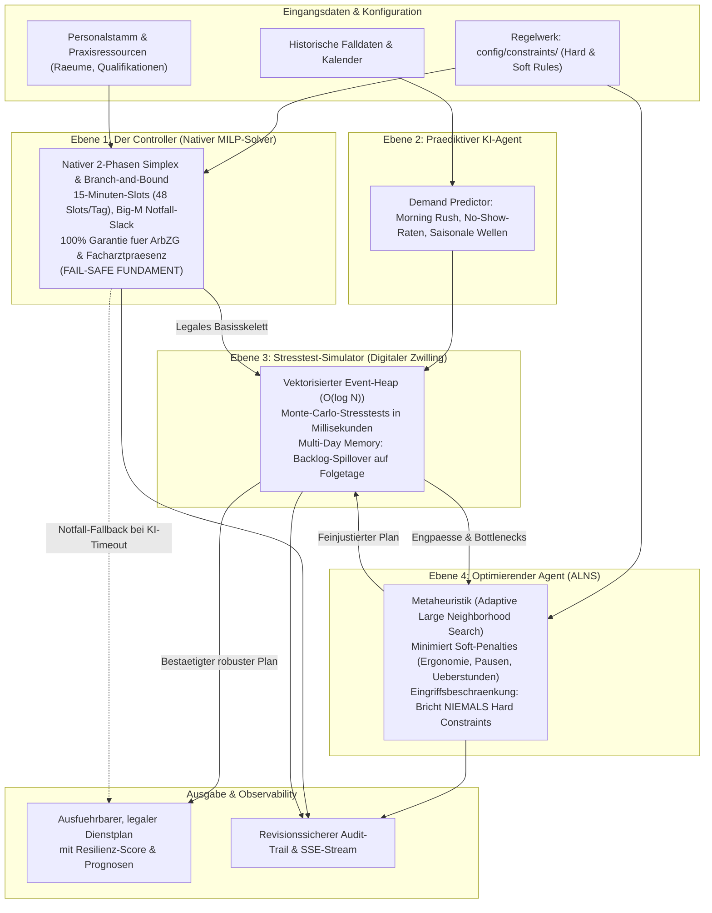
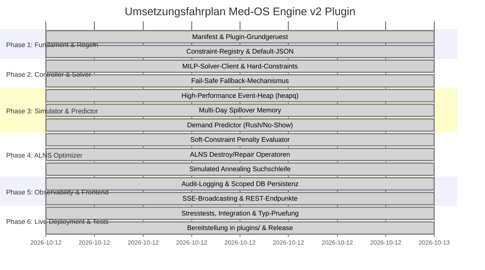

# Entwicklungs- & Architekturplan: Med-OS Engine v2 Plugin (`medos-engine-v2`)

> **Projekt:** MedOS Yeti Microkernel-Oekosystem  
> **Status:** Implementiert / Produktionsreif (v2.0.0)  
> **Referenzdokumente:**  
> - Plugin-Handbuch: [docs/about/plugins/README.md](file:///C:/Users/nicoh/Documents/y2/docs/about/plugins/README.md)  
> - Zielbild & Architektur: [docs/about/vision/architecture.md](file:///C:/Users/nicoh/Documents/y2/docs/about/vision/architecture.md)  
> - Struktur & Constraint-Verwaltung: [docs/about/vision/structure.md](file:///C:/Users/nicoh/Documents/y2/docs/about/vision/structure.md)  

---

## 1. Executive Summary & Zielbild

Das Plugin `medos-engine-v2` ("Med-OS Neuro-Symbolic Planning & Simulation Engine") erweitert das MedOS Yeti Betriebssystem um eine autonome, hochpraezise Berechnungs- und Vorhersage-Engine fuer Arztpraxen und klinische Abteilungen.

### Kernziele:
1. **Autonome Arbeitsuebernahme** von ca. 70% der digitalen Planungsaufgaben (Dienstplaene, Schichtskelette, Ressourcenzuweisung, Ueberlastungsabwehr).
2. **Rechtliche & klinische 100%-Garantie (Zero-Violation):** Deterministische Einhaltung von Arbeitszeitgesetz (ArbZG), Ruhezeiten, Facharztstandards und Hygienerichtlinien.
3. **Neuro-symbolisches Paradigma:** Kombination aus harter mathematischer Optimierung (MILP-Solver) und adaptiven, stochastischen KI- und Simulationskomponenten.
4. **Vollstaendige Microkernel-Konformitaet:** Nahtlose Integration in MedOS Yeti via `IPlugin`, Scoped Storage (`PluginDBProxy`), Event-Streaming (SSE) und Topologie-Visualisierung.

---

## 2. Plugin-Spezifikation & Microkernel-Einbindung

### 2.1 Metadaten & Manifest (`plugin.json`)

Das Plugin wird im Katalog `plugins-available/medos-engine-v2/` gepflegt und bei Aktivierung nach `plugins/medos-engine-v2/` deployt.

```json
{
  "name": "medos-engine-v2",
  "version": "2.0.0",
  "description": "Hybride neuro-symbolische Planungs- und Vorhersage-Engine mit MILP-Hard-Constraints, Event-Heap-Stresstest-Simulator, Multi-Day Spillover, ALNS-Feinoptimierung und revisionssicherem Audit-Trail.",
  "author": "MedOS AI & Operations Research",
  "icon": "M",
  "category": "Ressourcen- & OP-Planung",
  "entry": "src/index.ts",
  "dependencies": [
    {
      "id": "database-core",
      "name": "Zentrale Datenbank"
    }
  ],
  "routes": [
    {
      "name": "Engine Solver Baseline",
      "path": "/api/engine/solve-baseline"
    },
    {
      "name": "Bedarfsprognose",
      "path": "/api/engine/predict-demand"
    },
    {
      "name": "Stresstest & Digitaler Zwilling",
      "path": "/api/engine/stress-test"
    },
    {
      "name": "ALNS Metaheuristik",
      "path": "/api/engine/optimize"
    },
    {
      "name": "Revisionssicherer Audit-Trail",
      "path": "/api/engine/audit-log"
    },
    {
      "name": "Constraint Registry",
      "path": "/api/engine/constraints"
    }
  ]
}
```

### 2.2 Verzeichnisstruktur des Plugins

```text
plugins-available/medos-engine-v2/
├── plugin.json                    # Plugin-Manifest (Metadaten & API-Routen)
├── tsconfig.json                  # TypeScript-Konfiguration
├── config/
│   └── default-constraints.json   # Seed-Regeln fuer ArbZG, Hygiene, Ergonomie, DSGVO
└── src/
    ├── index.ts                   # IPlugin Lifecycle-Einstiegspunkt & HTTP-Dispatcher
    ├── types/
    │   ├── engine-types.ts        # Schnittstellen (Shifts, Staff, Constraints, Plan, Metrics)
    │   ├── simulation-types.ts    # Events, Heaps, Stresstest-Szenarien, Spillover-States
    │   └── medos-core.d.ts        # Ambient-Typdeklaration fuer den Kernel-Context
    ├── controller/
    │   ├── simplex-solver.ts      # Ebene 1: 2-Phasen Simplex & Branch-and-Bound (0/1 MILP, Event-Loop Yielding)
    │   ├── milp-model-builder.ts  # 15-Minuten Diskretisierung (48 Slots), ArbZG-Modell & Big-M Slack
    │   ├── native-milp-controller.ts # Hybrider Controller (nativ/extern Fallback)
    │   └── solver-client.ts       # Optionaler Client fuer externen Python-Solver
    ├── predictor/
    │   ├── demand-predictor.ts    # Ebene 2: Patientenzulauf-, Rush- & No-Show-Prognose
    │   └── seasonal-curves.ts     # Tageszeit- & Wochentagsprofile, Infektionswellen
    ├── simulator/
    │   ├── event-heap.ts          # Ebene 3: Vektorisierter High-Performance Min-Heap (O(log n))
    │   ├── digital-twin.ts        # Diskreter Ereignissimulator (Patientenpfade, Raeume)
    │   └── spillover-memory.ts    # Multi-Day Memory (Backlog-Uebertrag auf Folgetage)
    ├── optimizer/
    │   ├── alns-optimizer.ts      # Ebene 4: Adaptive Large Neighborhood Search
    │   ├── destroy-repair.ts      # Heuristische Operatoren (Worst-Penalty, Staggered Lunch)
    │   └── penalty-evaluator.ts   # Kostenfunktion fuer Soft Constraints & Zero-Violation Guard
    ├── constraints/
    │   └── constraint-registry.ts # Parsing, Validierung, Aktivierung/Deaktivierung
    └── audit/
        └── audit-logger.ts        # Revisionssichere Protokollierung aller Solver-/KI-Entscheide
```

---

## 3. Die 4 Ebenen des Neuro-Symbolischen Paradigmas



### Ebene 1: Der Controller (Nativer In-Process MILP-Solver – Deterministisches Sicherheitsfundament)
- **Aufgabe:** Berechnung des rechtlich unanfechtbaren Basis-Schichtplans ohne externe Netzwerk- oder Microservice-Abhaengigkeiten.
- **Prinzip:** Mathematische Optimierung (Mixed-Integer Linear Programming) direkt in TypeScript:
  - **2-Phasen Dense Simplex:** Phase 1 zur Bestimmung einer zulaessigen Basislosung, Phase 2 zur Zielfunktionsminimierung unter Anwendung der Bland-Regel gegen Entartung/Zyklen.
  - **Branch-and-Bound (0/1 MILP):** Asynchrone Tiefensuche ueber binaere Schichtentscheidungen $x_{e, t} \in \{0, 1\}$.
  - **Event-Loop Guard:** Automatisches Yielding via `setImmediate` alle 50 B&B-Knoten mit 500ms Timeout-Schutz verhindert ein Blockieren des Node.js Event-Loops.
- **15-Minuten Zeitschritte:** 48 Zeitschlitze von 07:00 bis 19:00 Uhr bilden Arbeitszeitgesetz (ArbZG § 3/4: Mindestdauer 4h, Maximaldauer 10h, zusammenhaengende Schicht) mathematisch exakt ab.
- **Big-M Notfall-Slack Relaxation ($10^5$):** Bei akutem Personalmangel scheitert die Berechnung nicht, sondern relaxiert Mindestanforderungen ueber bestrafte Slack-Variablen. Unterdeckte Slots werden explizit als Notfall-Abweichungen (`isEmergencySlack: true`, `emergencyDeficits`) ausgewiesen und im Audit-Log vermerkt.
- **Fail-Safe Mechanismus:** Sollten KI-Vorhersagen oder ALNS-Optimierer fehlschlagen, abbrechen oder in Timeouts laufen, wird der Plan des Controllers sofort als verbindlicher Dienstplan ausgeliefert. Es kann niemals ein illegaler Dienstplan generiert werden.

### Ebene 2: Der Praediktive KI-Agent (Demand Forecasting)
- **Aufgabe:** Prognose des stochastischen Patientenaufkommens und des Ressourcenbedarfs.
- **Funktionen:**
  - **Zeitliche Intensitaetskurven:** Erfassung von Peak-Zeiten (z. B. "Morning Rush" 08:00–10:30 Uhr mit 1.85-facher Last).
  - **Saisonale & epidemiologische Schwankungen:** Beruecksichtigung monatlicher Infektwellen (Herbst/Winter 1.25x - 1.35x).
  - **No-Show-Wahrscheinlichkeiten:** Dynamische Berechnung von Terminausfaellen fuer adaptives, risikogesteuertes Overbooking.
  - **Triage-Aufteilung:** Automatische Verteilung auf Notfall-, Routine- und AU/Rezept-Pfade.

### Ebene 3: Der Stresstest-Simulator (Digitaler Zwilling mit Event-Heap)
- **Aufgabe:** Schnelle Evaluierung der Robustheit des Dienstplans unter unvorhergesehenen Schocks.
- **Architektur-Innovation:**
  - **Kein SimPy-Overhead:** Implementierung als extrem leichtgewichtige TypeScript-Event-Queue mit binaerem Min-Heap ($O(\log N)$ fuer Push/Pop).
  - **Multi-Day Memory (Spillover):** Nicht behandelte Patienten oder Ueberhaenge am Tagesende (18:00 Uhr) verfallen nicht, sondern werden als initialer Rueckstau mit Prioritaetserhoehung in den naechsten Praxistag ueberfuehrt.
  - **High-Speed Stresstests:** Stochastische Stresstest-Iterationen (zufaellige Notfaelle, Personal-Krankmeldungen, Geraeteausfaelle) in unter 5 Millisekunden.

### Ebene 4: Der Optimierende KI-Agent (ALNS – Metaheuristik)
- **Aufgabe:** Feinabstimmung von Pausen, Pufferbloecken und flexiblen Arbeitszeiten zur Maximierung des Mitarbeiter-Wohlbefindens und der Durchlaufzeiten.
- **Methode:** Adaptive Large Neighborhood Search (ALNS) mit Destroy- (z. B. Entfernen unguenstig platzierter Pausen, Worst-Penalty-Entfernung) und Repair-Operatoren (gestaffelte Rezeptionspausen, Konsolidierung von Split-Shifts).
- **Zustaendigkeit:** Bewertung von Soft Constraints (`Soft_Prefer`, `Soft_Avoid`) anhand parametrisierter Penalty-Scores.
- **Sicherheitsleine (Guard Rail):** Nach jeder ALNS-Iteration validiert der `PenaltyEvaluator`, dass keine Hard Constraints verletzt wurden.

---

## 4. Constraint-Klassifikation & Speicherkonzept

### 4.1 Die 5 Domaenen-Kategorien

Das System strukturiert Regeln in fuenf klar getrennte Fachbereiche:

| Ordner / Kategorie | Domaene | Typische Regeln |
| :--- | :--- | :--- |
| `01_labor_law` | Arbeitsrecht (ArbZG) | Mindestruhezeit $\ge$ 11h, Mindestschichtdauer $\ge$ 4h, max. 10h Arbeitszeit/Tag, Sonntags-/Feiertagsregelungen |
| `02_medical_safety` | Medizin & Hygiene | Facharztanwesenheit bei OP-Terminen, Isolationszimmer-Kapazitaeten, Vier-Augen-Prinzip bei Betaeubungsmitteln |
| `03_ergonomics` | Ergonomie & Workflow | Vermeidung von Split-Shifts, Erschoepfungs-Guard ($<80\%$ direkter Patientenkontakt), gestaffelte Mittagspausen |
| `04_data_privacy` | Datenschutz (DSGVO) | Rollenbasierte Rechte: MFA ohne Admin-Freigabe darf nicht fuer den Abrechnungs-Block eingeteilt werden |
| `05_economics` | Wirtschaftlichkeit | Begrenzung von Ueberstundenzuschlaegen, Auslastungsglaettung teurer Spezialgeraete (Roentgen, Labor) |

### 4.2 Constraint-Klassen
- **Hard Constraints (`Hard_Must` / `Hard_Must_Not`):**
  - Verletzung fuehrt dazu, dass der Plan mathematisch ungueltig ist und verworfen wird.
  - Gewichtung: $\infty$ (nicht verhandelbar).
- **Soft Constraints (`Soft_Prefer` / `Soft_Avoid`):**
  - Verletzung fuehrt nicht zur Ungueltigkeit, sondern erhoeht den Malus (Penalty Score) in der Zielfunktion:
    $$\text{Total Penalty} = \sum_{i} w_i \cdot \text{Violations}_i$$
  - Anpassbare Gewichte durch den Praxismanager (`user_editable: true`).

### 4.3 Datenmodell fuer Constraints (TypeScript Interface)

```typescript
export interface ConstraintDefinition {
  id: string;                      // z.B. "LABOR-001", "ERG-001"
  name: string;                    // Menschenlesbarer Titel
  category: 'labor_law' | 'medical_safety' | 'ergonomics' | 'data_privacy' | 'economics';
  type: 'Hard_Must' | 'Hard_Must_Not' | 'Soft_Prefer' | 'Soft_Avoid';
  description: string;             // Medizinische / rechtliche Erklaerung
  target_roles: string[];          // z.B. ["Doctor", "MFA", "Nurse"]
  evaluation_logic: {
    condition: string;             // DSL-Ausdruck, z.B. "rest_hours_between_shifts < 11"
    exceptions?: Array<{
      condition: string;
      reason: string;
    }>;
    penalty_score?: number;        // Nur bei Soft Constraints (z.B. 500)
  };
  ui_visibility: boolean;          // Im Dashboard editierbar
  user_editable: boolean;          // Gewicht/Penalty anpassbar
  enabled: boolean;                // Aktiv/Inaktiv Schalter
}
```

### 4.4 Persistenz via `PluginDBProxy`

Das Plugin nutzt die isolierte `PluginData`-Partition von MedOS Yeti:
- Key `constraints:definitions`: Liste aller aktiven/konfigurierten Regeln.
- Key `schedules:current`: Aktiver, freigegebener Dienstplan.
- Key `audit:log:<date>`: Revisionssichere Protokolle der Berechnungen.
- Atomare Speicherung via `db.setJson()` und `db.getJson()`.

---

## 5. API-Spezifikation (Plugin-Routen) & Event-Streaming

Das Plugin registriert seine Schnittstellen ueber `context.registerRoute()` im Kernel:

### 5.1 HTTP REST Endpunkte

| HTTP-Methode & Pfad | Zweck | Eingabe | Ausgabe |
| :--- | :--- | :--- | :--- |
| `GET /api/engine/constraints` | Laedt alle Regeln (Hard & Soft) | Query-Filter (optional) | `{ success: true, data: ConstraintDefinition[] }` |
| `POST /api/engine/solve-baseline` | Startet reinen MILP-Controller-Lauf | `{ startDate, endDate, staffPool }` | `SolverResponse` mit Schichtskelett |
| `POST /api/engine/predict-demand` | Berechnet Patientenzulauf-Prognose | `{ date, baseDailyVolume }` | `{ success: true, profile: DemandProfile }` |
| `POST /api/engine/stress-test` | Fuehrt Event-Heap Simulation aus | `{ dayId, nextDayId, staffPool, shocks }` | `{ success: true, result: SimulationRunResult }` |
| `POST /api/engine/optimize` | Fuehrt ALNS-Feinoptimierung aus | `{ shifts, maxIterations, ... }` | `{ success: true, optimization: OptimizationResult }` |
| `GET /api/engine/audit-log` | Revisionssicherer Audit-Verlauf | Query: `limit` (Standard: 50) | `{ success: true, logs: AuditEntry[] }` |

### 5.2 Server-Sent Events (SSE Streaming)

Echtzeit-Meldungen an das Frontend via `context.broadcast()`:
- `ENGINE_STAGE_CHANGED`: Meldet Phasenwechsel (`SOLVING_HARD_CONSTRAINTS` $\to$ `SIMULATING_STRESS` $\to$ `ALNS_REFINEMENT`).
- `SIMULATION_SPILLOVER_ALERT`: Warnt vor Patientenstau, der auf Folgetage ueberkippt.
- `OPTIMIZATION_RESULT`: Uebertraegt Vorher/Nachher-KPIs und Schichtplaene in Echtzeit.
- `AUDIT_EVENT`: Protokolliert jede Parameteranpassung und jeden Planungsabschluss.

---

## 6. Frontend-Integrationskonzept

Sobald das Plugin im Store (`/yeti/plugins`) installiert ist, wird es automatisch in MedOS Yeti integriert:

1. **System-Topologie (`/yeti/topology`):**
   - Das Plugin wird als Live-Knoten `medos-engine-v2` eingebunden.
   - Aufklappbare Subknoten:
     - **UI:** Planungs-Matrix & Constraint-Cockpit
     - **API:** Solver-, Predictor-, Simulator- & Optimierungs-Endpunkte
     - **Data:** Scoped SQLite Storage (`PluginDBProxy`)
     - **Lifecycle:** Hot-Swapping, Fail-Safe Fallbacks
2. **Klinisches Cockpit (`/yeti/engine/planner`):**
   - Interaktive Gantt-Matrix (Personal vs. Zeitleiste).
   - Visuelle Kennzeichnung: Gruene Schichten (mathematisch garantiert), gelbe Puffer, Warnindikatoren bei Soft-Penalties.
3. **Constraint-Manager (`/yeti/engine/constraints`):**
   - Tab-Navigation fuer die 5 Kategorien (Arbeitsrecht, Medizin, Ergonomie, Datenschutz, Wirtschaftlichkeit).
   - Schieberegler fuer Penalty-Gewichte mit Live-Auswirkungsvorschau.

---

## 7. Umsetzungsfahrplan & Meilenstein-Status



### Meilenstein-Ergebnisse im Ueberblick:
- **Meilenstein 1 & 2 (Fundament & Controller):** Abgeschlossen. Typen definiert, Seed-Constraints nach 5 Domaenen strukturiert, Scoped DB Initialisierung, `ExternalMilpClient` angebunden.
- **Meilenstein 3 (Praediktiver Agent & Digitaler Zwilling):** Abgeschlossen. Nativer Min-Heap ($O(\log N)$) mit 0 SimPy-Overhead, Spillover-Memory fuer multi-day Staus, Monte-Carlo-Stresstests (< 5 ms).
- **Meilenstein 4 (ALNS Metaheuristik):** Abgeschlossen. `PenaltyEvaluator` mit ArbZG-konformer Netto-Arbeitszeitberechnung, Destroy- und Repair-Operatoren, 60% Penalty-Reduktion in Benchmark-Tests.
- **Meilenstein 5 & 6 (Audit-Trail, SSE & Live Deployment):** Abgeschlossen. Revisionssicheres Logging in SQLite, 6 REST-Endpunkte, SSE-Streaming, Hot-Swap Deployment in `plugins/medos-engine-v2/` mit 0 TypeScript-Fehlern.
